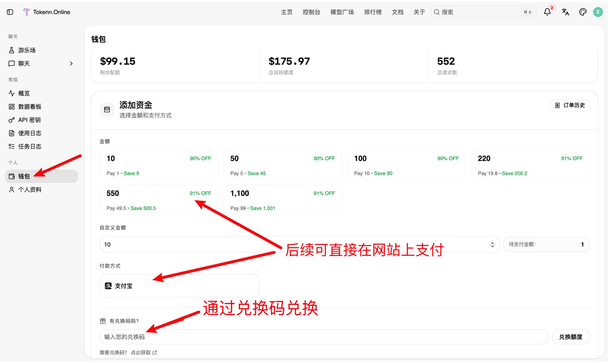
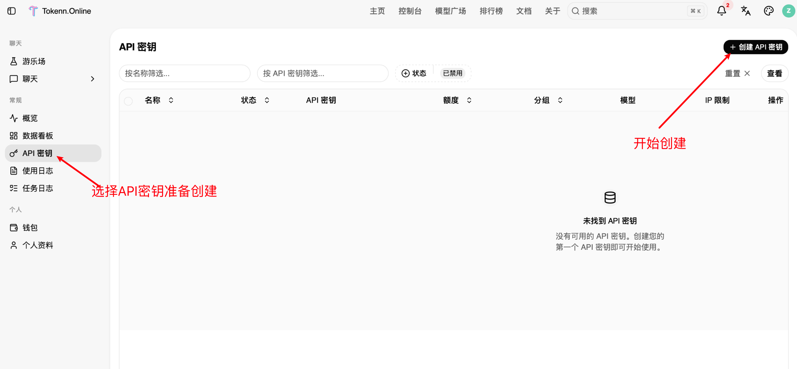
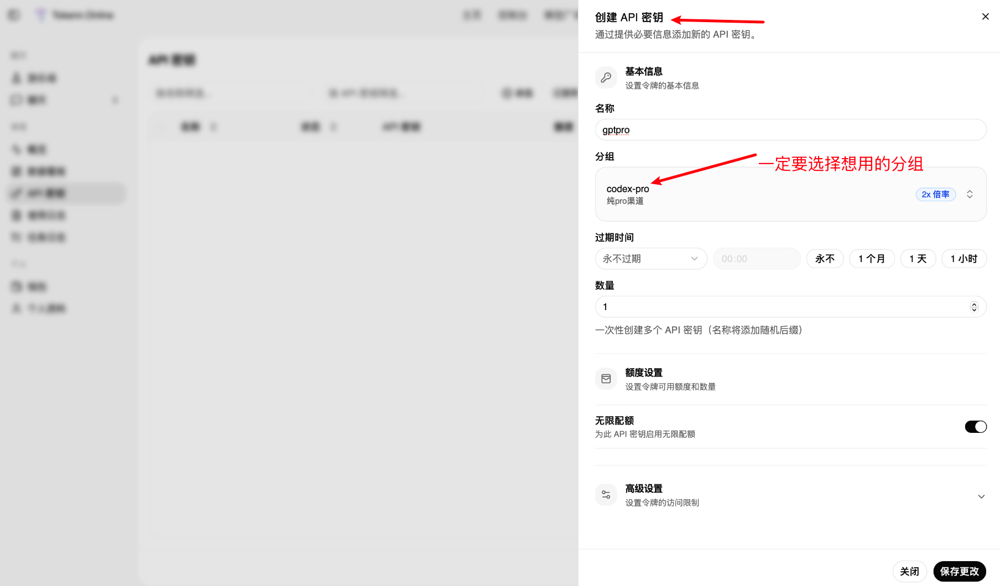
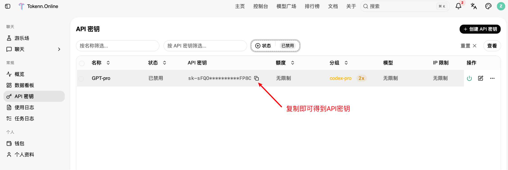
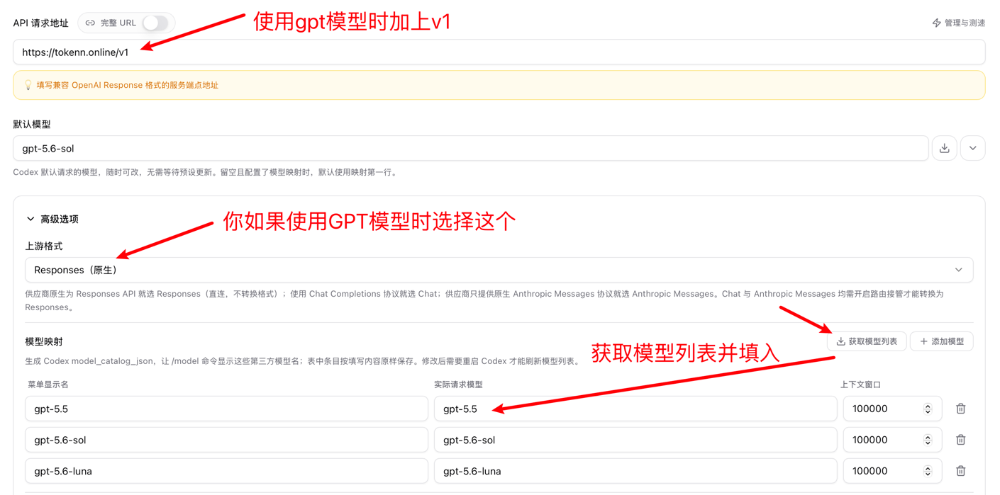
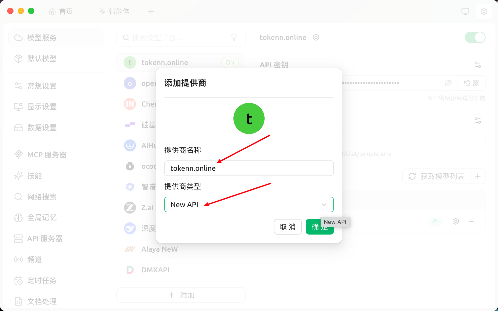
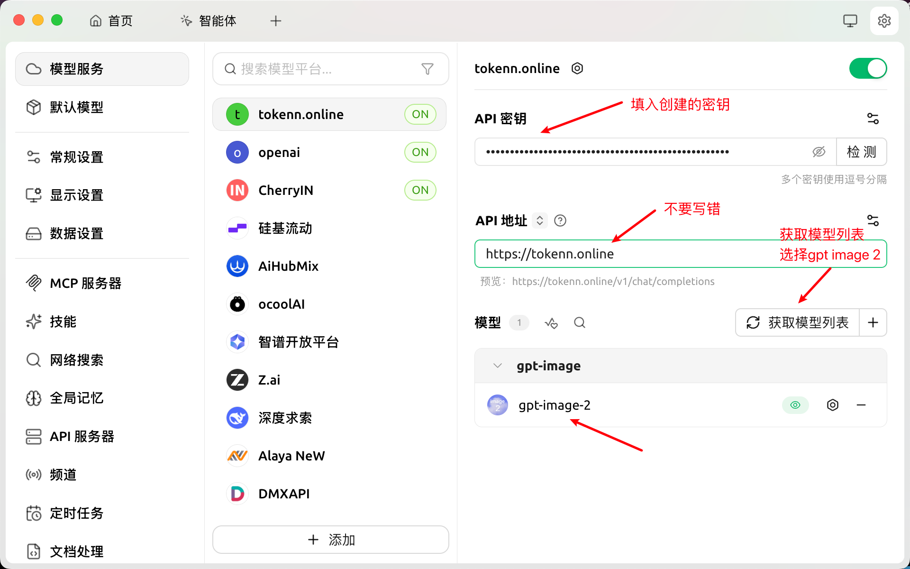
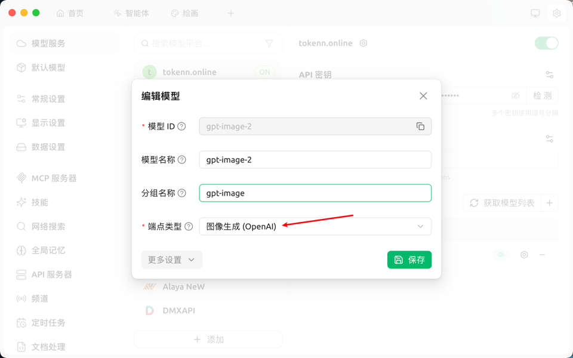
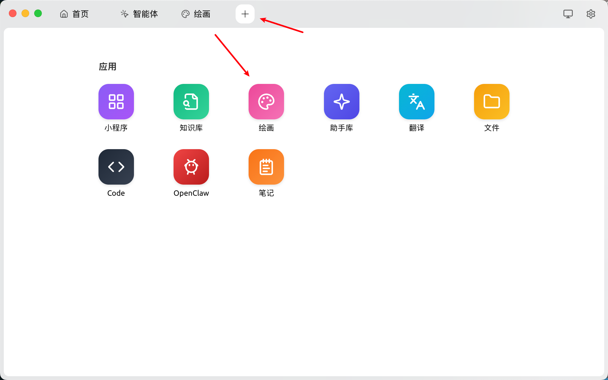
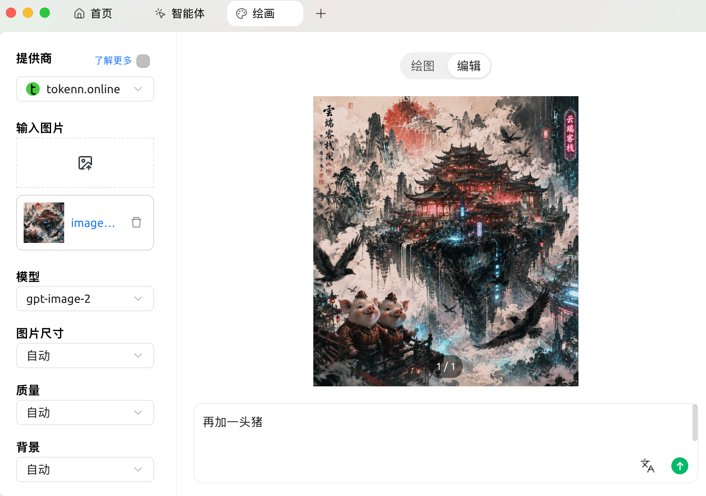

# 通过兑换码获取额度

**控制台\-钱包\-输入兑换码\-点击兑换额度即可**




**创建令牌获取key**

令牌管理\-添加令牌\-输入名称\-选择默认分组\-点击提交\-复制key



**注意 请务必选择分组 ,不同分组之间倍率不同,价格不同,选择自己想用的分组**






# 通过CCSwitch配置密钥(Claude Code Cli、ChatGPT等等)

**https://www\.runoob\.com/vibe\-coding/cc\-switch\.html**** 这里可以下载ccswitch**

配置方法:

随着 Claude Code、OpenAI Codex、Gemini CLI 等 AI 编程工具的流行，开发者往往需要在多个 API 提供商之间频繁切换——官方 API、国内镜像、第三方代理……每次手动修改配置文件既繁琐又容易出错。

CC Switch 就是解决这个痛点的桌面工具，它提供一个统一的图形界面，让你可以： 一键切换 API

| 功能                | 说明                                                         |
| ------------------- | ------------------------------------------------------------ |
| 🔄 一键切换 Provider | 保存多套 API 配置，点一下即可切换，无需手动编辑 JSON         |
| 🖥️ 多应用统一管理    | 同时管理 Claude Code、Codex、Gemini CLI、OpenCode、OpenClaw 五款工具 |
| 🛡️ 本地 API 代理     | 内置高性能 HTTP 代理，支持自动故障转移与请求监控             |
| 🔌 MCP 服务器管理    | 可视化添加、编辑和同步 MCP 服务器配置                        |
| 📊 用量统计          | 实时查看 Token 消耗与 API 费用                               |
| 💾 备份与恢复        | 自动备份配置，防止误操作导致数据丢失                         |

支持管理的应用

- 🤖 **Claude Code**（Anthropic）

- ⚡ **Codex**（OpenAI）

- ✨ **Gemini CLI**（Google）

- 🧩 **OpenCode**（开源）

- 🦅 **OpenClaw**（第五款应用，v3\.11\.0 新增）

## 安装

前往 [GitHub Releases: ](https://github.com/farion1231/cc-switch/releases/latest)[https://github\.com/farion1231/cc\-switch/releases/latest](https://github.com/farion1231/cc-switch/releases/latest) 下载对应平台的安装包。

拉到网页最底部，资源包部分，下载对应平台的安装包：


### 系统要求

| 系统    | 最低版本                         | 架构                                    |
| ------- | -------------------------------- | --------------------------------------- |
| Windows | Windows 10 及以上                | x64                                     |
| macOS   | macOS 10\.15 \(Catalina\) 及以上 | Intel \(x64\) / Apple Silicon \(arm64\) |
| Linux   | 见下表                           | x64 / arm64                             |

### Windows

| 文件                                    | 说明                                 |
| --------------------------------------- | ------------------------------------ |
| `CC-Switch-vX.X.X-Windows.msi`          | ✅ **推荐**——MSI 安装包，支持自动更新 |
| `CC-Switch-vX.X.X-Windows-Portable.zip` | 便携版，解压即用，不写注册表         |

双击 MSI 文件，按向导完成安装后，在开始菜单搜索"CC Switch"启动即可。

> ⚠️ Windows 版本已禁用"一键安装"功能，以避免协议处理器的副作用。如需安装 Claude Code 等工具，请手动安装后再通过 CC Switch 管理。
>
>

### macOS

**方式一：直接下载（推荐）**

1. 下载 `CC-Switch-vX.X.X-macOS.zip`

2. 解压后将 `CC Switch.app` 拖入「应用程序」文件夹

3. 首次启动时右键点击 → 打开，或前往「系统设置 → 隐私与安全性 → 仍要打开」

> ⚠️ 由于作者没有 Apple 开发者账号，macOS 可能提示"未知开发者"。关闭提示后，前往「系统设置 → 隐私与安全性」点击「仍要打开」，之后每次均可正常启动。
>
>


**方式二：Homebrew**

```C#
# 添加 tap 并安装
brew tap farion1231/ccswitch
brew install --cask cc-switch
# 更新
brew upgrade --cask cc-switch
```

### Linux

根据发行版选择对应格式：

| 发行版                 | 推荐格式    | 安装命令                                |
| ---------------------- | ----------- | --------------------------------------- |
| Ubuntu / Debian / Mint | `.deb`      | `sudo apt install ./CC-Switch-*.deb`    |
| Fedora / RHEL / Rocky  | `.rpm`      | `sudo dnf install ./CC-Switch-*.rpm`    |
| openSUSE               | `.rpm`      | `sudo zypper install ./CC-Switch-*.rpm` |
| Arch / Manjaro / 其他  | `.AppImage` | 见下方                                  |

AppImage 使用方式：

```CSS
chmod +x CC-Switch-*.AppImage
./CC-Switch-*.AppImage
```

## 快速上手

安装完成后，按以下步骤完成首次配置：

**第一步：启动 CC Switch**

首次启动时，CC Switch 会自动检测已安装的 CLI 工具并尝试导入现有配置，系统托盘中会出现 CC Switch 图标。

**第二步：选择要管理的应用**

主界面顶部是应用切换栏，点击对应图标（Claude Code / Codex / Gemini CLI 等）即可切换当前管理的应用，你可以在设置中隐藏不需要的应用。


**第三步：添加第一个 Provider**

点击右上角的 \+ ，从内置预设中选择（如官方 Anthropic API、DeepSeek、阿里百炼等），或手动填写以下信息：


- **名称**：便于区分的备注名

- **API Key**：服务商提供的密钥

- **请求地址(Base URL)**：https://tokenn.online

- **模型**：指定默认使用的模型名称

- **API 格式**：Anthropic Messages 原生格式(Claude Code) 或 OpenAI Chat Completions 兼容格式(国产或其他非GPT模型)以及Responses(原生)





**第四步：切换 Provider**

在列表中点击目标 Provider，再点击「启用」，CC Switch 会自动将配置写入对应 CLI 工具的配置文件:

在终端直接运行 `claude` 命令时，即会使用新配置。

如果是codex,需要重启codex才行


# 安装claude code

## Windows 配置

如过你是小白什么都没有弄过就一步一步来

### 3\.1 安装 Node\.js

点击网址https://nodejs\.org


下载好之后安装就行 全部选默认的参数就行


### 3\.2 安装 git

点击网址https://git\-scm\.com/install/windows


点击对应的安装包下载完成 安装就行

### 3\.3 安装Claude code

打开 PowerShell 或 CMD，运行以下命令：

```Bash
npm install -g @anthropic-ai/claude-code
```

安装完成后，输入以下命令检查Node\.js，git ，Claude code 是否安装成功：

```Bash
node --version      
```

```Bash
npm --version 
```

```Bash
claude --version     
```

如下图所示，如果显示版本号，恭喜你！Claude Code 已经成功安装了。


### 3\.4 配置环境变量

最好下面两个一起配置

#### 3\.4\.1 配置settings\.json文件

创建\(如果不存在\)   或  编辑    C:\\Users\\用户名\\\.claude\\settings\.json，输入以下值并保存

```Bash
{
  "env": {
    "ANTHROPIC_AUTH_TOKEN": "替换为您的API Key",
    "ANTHROPIC_BASE_URL": "https://www.tokenn.online"
  },
  "permissions": {
    "allow": [],
    "deny": []
  }
}
```

#### 3\.4\.2 配置环境变量

```Bash
@echo off
echo ========================================
echo   Claude Code Environment Setup
echo ========================================
echo.

set /p API_KEY=Please enter your API Key:

if "%API_KEY%"=="" (
    echo Error: API Key cannot be empty!
    pause
    exit /b 1
)

echo.
echo Setting environment variables...

setx ANTHROPIC_AUTH_TOKEN "%API_KEY%"
setx ANTHROPIC_BASE_URL "https://www.tokenn.online"

echo.
echo ========================================
echo   Setup Complete!
echo ========================================
echo.
echo Environment variables set:
echo   ANTHROPIC_AUTH_TOKEN = %API_KEY%
echo   ANTHROPIC_BASE_URL = https://www.tokenn.online
echo.
echo Please restart your terminal for changes to take effect.
echo.
pause
```

将其保存为bat文件,点击运行,输入apikey    回车   即设置完成

### 3\.5 打开Claude code终端

打开终端 输入 Claude  回车 即可正常使用Claude


 

## **Mac 配置 **

### **前置条件**

确保已安装 Node\.js（版本 \>= 18）和 Claude Code CLI

**安装 Node\.js：**

```Plain Text
node -v
```

如果显示 `command not found`，需要先安装：

- 访问 [https://nodejs\.org](https://nodejs.org/) 下载 macOS 安装包

- 双击下载的 `.pkg` 文件，按提示完成安装

**安装 Claude Code CLI：**

```Bash
npm install -g @anthropic-ai/claude-code
```

下载好了之后验证一下

```Bash
claude --version     
```

显示版本号 说明下载成功

### 配置环境

配置其中一个不行 就两个办法一起配置

#### 方法1：环境变量设置

1. 编辑 shell 配置文件（根据使用的 shell 选择）：

   ```Bash
   # 如果是 bash（默认）
   echo 'export ANTHROPIC_BASE_URL="https://tokenn.online"' >> ~/.bash_profile
   echo 'export ANTHROPIC_AUTH_TOKEN="替换为您的API Key"' >> ~/.bash_profile
   
   
   # 如果是 zsh
   echo 'export ANTHROPIC_BASE_URL="https://tokenn.online"' >> ~/.zshrc
   echo 'export ANTHROPIC_AUTH_TOKEN="替换为您的API Key"' >> ~/.zshrc
   
   ```

#### 方法2：配置settings\.json

- 执行以下代码

  ```Bash
  mkdir -p ~/.claude
  ```

  ```Bash
  cat > ~/.claude/settings.json << 'EOF'
  {
    "env": {
      "ANTHROPIC_AUTH_TOKEN": "替换为您的API Key",
      "ANTHROPIC_BASE_URL": "https://tokenn.online"
    },
    "permissions": {
      "allow": [],
      "deny": []
    }
  }
  EOF
  
  ```

## **Linux 配置**

#### 方法1：临时设置（仅当前终端有效）

- 在 **终端** 中执行：

  ```Bash
  export ANTHROPIC_BASE_URL="https://tokenn.online"
  export ANTHROPIC_AUTH_TOKEN="替换为您的API Key"
  ```

#### 方法2：永久设置

1. 编辑 shell 配置文件（根据使用的 shell 选择）：

   ```Bash
   # 如果是 bash
   echo 'export ANTHROPIC_BASE_URL="https://tokenn.online"' >> ~/.bashrc
   echo 'export ANTHROPIC_AUTH_TOKEN="替换为您的API Key"' >> ~/.bashrc
   
   # 如果是 zsh
   echo 'export ANTHROPIC_BASE_URL="https://tokenn.online"' >> ~/.zshrc
   echo 'export ANTHROPIC_AUTH_TOKEN="替换为您的API Key"' >> ~/.zshrc
   ```

2. 立即生效：

   ```Bash
   source ~/.bashrc  # 或 source ~/.zshrc
   ```

#### 方法3：配置settings\.json

- 创建 `~/.claude/settings.json` 文件，内容如下：

  ```Bash
  {
    "env": {
      "ANTHROPIC_AUTH_TOKEN": "替换为您的API Key",
      "ANTHROPIC_BASE_URL": "https://tokenn.online"
    },
    "permissions": {
      "allow": [],
      "deny": []
    }
  }
  ```


---

### **通用验证方法**

在所有系统中，可以通过以下命令验证是否设置成功：

```Bash
# macOS/Linux
echo $ANTHROPIC_BASE_URL
echo $ANTHROPIC_AUTH_TOKEN

# Windows PowerShell
echo $env:ANTHROPIC_BASE_URL
echo $env:ANTHROPIC_AUTH_TOKEN

# Windows CMD
echo %ANTHROPIC_BASE_URL%
echo %ANTHROPIC_AUTH_TOKEN%
```


# 安装ChatGPT(即Codex)

本站claudecode 和 codex 额度通用

## windows

### **1、安装Codex**

使用 `npm` 进行安装

```Plain Text
npm install -g @openai/codex
```

### **2、配置文件**

创建\(如果不存在\)或编辑文件 `~`` C:\Users\用户名\``.codex\config.toml`

```Plain Text
model_provider = "tokenn.online"
model = "gpt-5.4"
model_reasoning_effort = "high"
disable_response_storage = true


[model_providers.tokenn.online]
name = "tokenn.online"
base_url = "https://tokenn.online/v1"
wire_api = "responses"
requires_openai_auth = true
```

创建\(如果不存在\)或编辑文件 `~\.codex\auth.json`

在网站添加一个GPT分组的令牌  复制API key 填入下方即可

```JSON
{
  "OPENAI_API_KEY": "替换为您的API Key"
}
```


## MAC

**下面是MAC 安装方法**

1\.安装codex  终端输入：

```Plain Text
sudo npm install -g @openai/codex
```

2\.将下方代码中的 `你的APIkey` 替换成你自己的 API Key，然后把整段代码复制到终端运行：

```JSON
mkdir -p ~/.codex

cat > ~/.codex/config.toml <<'EOF'
model_provider = "tokenn.online"
model = "gpt-5.4"
model_reasoning_effort = "high"
disable_response_storage = true

[model_providers.tokenn.online]
name = "tokenn.online"
base_url = "https://tokenn.online/v1"
wire_api = "responses"
requires_openai_auth = true
EOF

cat > ~/.codex/auth.json <<'EOF'
{
  "OPENAI_API_KEY": "你的APIkey"
}
EOF
```


# GPT-Image-2 绘图教程


**[前置准备]**

找到支持`gpt-image-2` 模型的分组，并创建令牌。

## 使用cherry studio通过GPT image 2绘图

1. 创建令牌分组包含gpt-image 2的令牌。创建好令牌后，点击复制按钮，将 API Key 复制到剪切板。
2. 访问 [Cherry Studio](https://www.cherry-ai.com/) 官网下载并安装软件。
3. 打开 Cherry Studio，点击左下角设置按钮，进入 `模型服务` 页面，点击底部的 `添加` 按钮新增提供商。
4. 在添加提供商窗口中填写提供商名称，例如 `tokenn.online-gpt-image-2`，`提供商类型` 选择 `New API`，然后点击 `确定`。



1. 在左侧列表中找到刚添加的提供商，将第 1 步复制的分组 API Key 填入 `API 密钥`，`API 地址` 填写 `https://tokenn.online`。



1. 点击模型区域右侧的 `获取模型列表`，刷新后添加 `gpt-image-2` 模型。添加完成后，可以在提供商配置页中看到模型列表里已经出现 `gpt-image-2`。
2. 点击 `gpt-image-2` 右侧的编辑按钮，进入编辑模型窗口，将 `端点类型` 设置为 `图像生成（OpenAI）`，然后点击 `保存`。


回到首页，点击顶部的 `+` 按钮，在应用列表中选择 `绘画`。




1. 进入绘画页面后，左侧 `提供商` 选择刚才添加的供应商，`模型` 选择 `gpt-image-2`。首次使用建议先将 `图片尺寸`、`质量`、`敏感度` 等选项保持为 `自动`，`生成数量` 保持为 `1`。



1. 如果只需要根据提示词生成图片，顶部选择 `绘图` 模式，输入提示词后点击发送按钮即可开始生成。
2. 如果需要上传参考图进行图生图或局部修改，顶部切换到 `编辑` 模式，在左侧 `输入图片` 中上传参考图，再输入修改要求后点击发送按钮。


使用建议

- `API 地址` 直接填写 `https://tokenn.online`  即可，Cherry Studio 会自动拼接兼容端点，无需手动补 `/v1`。
- 如果模型列表中没有 `gpt-image-2`，请先在 `管理` 中刷新模型；如果仍无法正常绘图，请检查 `端点类型` 是否为 `图像生成（OpenAI）`。
- 使用 `绘图` 模式可以进行文生图；使用 `编辑` 模式可以上传参考图进行图生图或局部修改。
- 如果你在普通对话页中直接调用 `gpt-image-2`，建议关闭 `流式输出`，避免返回内容解析异常。使用 `绘画` 应用时通常不需要额外处理。

### [可能出现的问题]

如果 Cherry Studio 弹出 `Failed to fetch`，通常是请求连接被中断，可能与本机代理或网络环境有关。可以先检查代理设置，确认 Cherry Studio 能正常访问 `https://tokenn.online` 后再重试。

如果 Cherry Studio 弹出 `Unexpected token '<', "<html><h"... is not valid JSON`，通常是请求过程中收到了 Cloudflare 等页面内容，客户端按 JSON 解析时显示异常。遇到这种情况可以直接重试，或稍后再重新生成。


